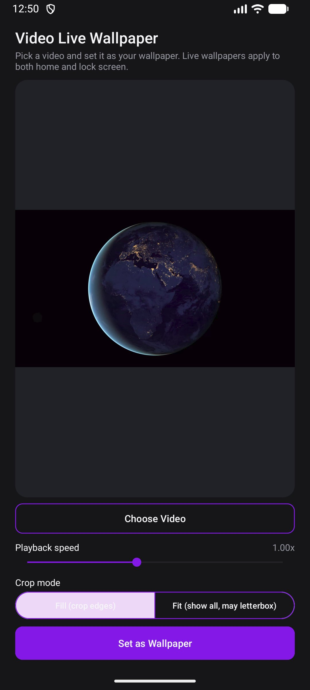
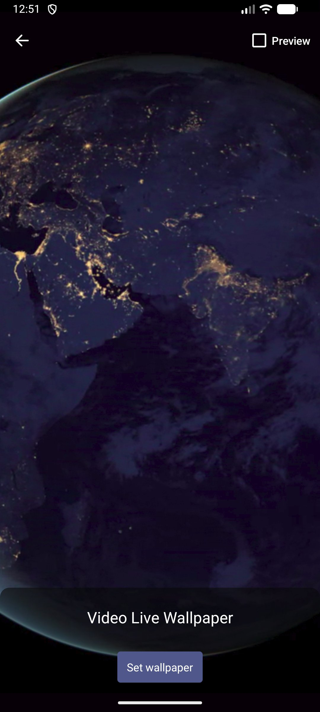

# Video Live Wallpaper

A lightweight Android app that turns a video or animated GIF from your device into a live wallpaper.

<p align="center">
  
  
</p>

## Features

- Pick a video or animated GIF with the system file picker
- Preview your selected video or GIF before setting it
- Choose whether videos loop continuously or play once and hold the final frame
- Optional one-shot video animation each time the phone is unlocked
- Adjustable playback speed (0.25x–2.0x)
- Always-on Fill scaling: the wallpaper covers the display edge to edge
- Portrait phone videos display the right way up
- One-tap wallpaper setting through Android's own live wallpaper picker
- No ads, no analytics, no network access of any kind

## Install

- **F-Droid:** [Video Live Wallpaper on F-Droid](https://f-droid.org/packages/io.github.codeg0blin.videowallpaper/)
- **GitHub:** download the APK from the [Releases](https://github.com/codeg0blin/video-live-wallpaper/releases) page.

Requires Android 8.0 (API 26) or newer.

## How it works

The app implements an Android `WallpaperService` that plays the chosen video using `MediaPlayer`. Video looping is optional; when disabled, playback stops at the end and the final frame remains visible. The optional unlock animation prepares the first frame while the screen is off, then plays the video after the phone is unlocked. Decoded frames go to a `SurfaceTexture` and are drawn with a small OpenGL ES 2.0 renderer (`VideoFrameRenderer.kt`), which applies the video's rotation and always uses Fill scaling to cover the display.

GIFs (version 1.3.0) don't go through `MediaPlayer`. `GifDecoder.kt` is a small pure-Kotlin GIF89a decoder written for this app, and `GifPlayer.kt` shows one frame at a time, timed by each frame's own delay divided by your speed setting. Frames are uploaded as textures to the same renderer, so GIFs also use the same edge-to-edge Fill scaling. GIF playback remains animated and looping. The app recognises GIFs by their file header rather than their file name. Transparent areas of a GIF are drawn black, and GIF files over 50 MB are not supported.

Setting the wallpaper goes through Android's own system picker (`ACTION_CHANGE_LIVE_WALLPAPER`). The OS requires this for all live wallpaper apps, not just this one.

Android applies a live wallpaper to the home screen and lock screen together, and the live wallpaper API has no per-screen setting. Some devices' system pickers may still offer extra choices; if yours does, the video plays on whichever screens you select.

## Privacy

The app has no internet permission and contains no analytics, tracking or advertising code. The only thing it stores is a reference (URI) to the video or GIF you picked, kept locally in `SharedPreferences` on your device.

## Building

Open the project in Android Studio, or build from the command line:

```
./gradlew assembleDebug
./gradlew assembleRelease
```

Unit tests for the GIF decoder run with `./gradlew test`.

Requires JDK 17 and Android SDK 34 (`compileSdk`/`targetSdk` 34, `minSdk` 26).

## Changelog

Per-version release notes are in [`fastlane/metadata/android/en-US/changelogs`](fastlane/metadata/android/en-US/changelogs), named by version code.

## Contributing

Bug reports and suggestions are welcome via [issues](https://github.com/codeg0blin/video-live-wallpaper/issues).

## License

Apache License 2.0. See [LICENSE](LICENSE) and [NOTICE](NOTICE).

See [ATTRIBUTION.md](ATTRIBUTION.md) for a full list of the open-source libraries this app depends on, and a note on how the source code itself was written.
